# Repositorio Nacional · Plataforma de monitoreo de perforación en tiempo real

> Proyecto profesional desarrollado por **Limber Magaña**.
> Este repositorio es solo de presentación: **no contiene código fuente**. El código es privado y las capturas usan **datos ficticios** de un simulador; no muestran pozos, usuarios ni servidores reales.

Plataforma web para el equipo de **monitoreo de perforación en tiempo real**. Reúne en un solo lugar las herramientas del día a día: validar la **calidad de los datos WITSML** que llegan de los pozos, revisar trayectorias, comparar contra la **normativa de envío de datos**, generar curvas de avance y llevar el control operativo de los pozos.

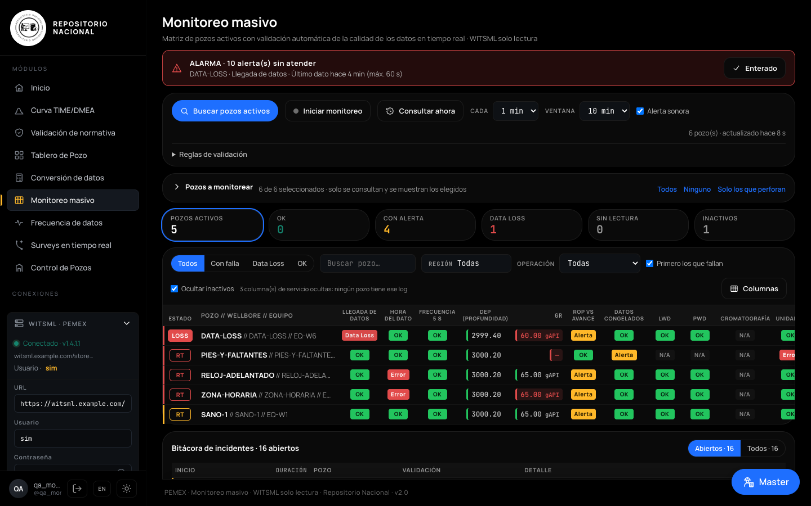

---

## El problema

Un monitorista revisa decenas de pozos al mismo tiempo, cada uno con varias compañías de servicio enviando datos por WITSML. Las fallas de calidad (datos que dejan de llegar, horas mal configuradas, unidades equivocadas, sensores congelados, profundidades que no cuadran) se detectaban a ojo, pozo por pozo y en herramientas separadas.

## Qué construí

| Módulo | Para qué sirve |
|---|---|
| **Monitoreo masivo** | Matriz de todos los pozos activos con validación automática de la calidad del dato y alarmas. |
| **Master (asistente)** | Asistente de calidad de datos que explica cada validación, prioriza pozos y redacta el mensaje para la compañía de servicio. |
| **Surveys en tiempo real** | Valida la coherencia geométrica y física de las trayectorias, compara real contra plan y avisa de surveys atrasados. Vistas lateral, de planta y 3D. |
| **Frecuencia de datos** | Verifica que el log de tiempo llegue cada 5 s, como pide la normativa. |
| **Validación de normativa** | Compara mnemónicos y unidades de un pozo contra la normativa de envío de datos guardada en la base de datos. |
| **Curva de avance TIME/DMEA** | Genera la curva de avance del programa de perforación (lectura asistida por IA) y la exporta a Excel. |
| **Tablero de pozo** | Lee el tablero de control en PDF y lo convierte en indicadores por región. |
| **Control de Pozos** | Gestión operativa compartida por equipo: estado de pozos, pendientes, notas de turno, reporte de turno, integración con Excel y WhatsApp. |

### Monitoreo masivo: lo que valida

Pensado como lo trabaja un analista de calidad de datos WITSML junto al monitorista. Primero se revisa que el dato llegue, luego que sea el correcto y al final que sea coherente.

- **Llega:** Data Loss, frecuencia de 5 s, hora del dato (reloj del equipo adelantado, zona horaria mal configurada, marcas duplicadas o desordenadas).
- **Es el correcto:** mnemónicos y unidades contra la normativa. El sistema reconoce solo qué formato aplica al pozo (superficie, fondo, terminaciones, tubería flexible…).
- **Es coherente:**
  - Al perforar, el agujero y la barrena avanzan igual.
  - El ROP corresponde a la operación y se convierte a la unidad de la normativa.
  - Los parámetros que deben moverse según la operación no llegan fijos ni en línea recta (interpolados).
  - LWD y PWD se revisan por separado, cada sensor a su distancia de la barrena. El sistema estima esa distancia según cómo llegan los datos y el usuario la valida.
  - Cromatografía: llega en su propio log, el orden C1 ≥ C2 ≥ C3 se cumple y los componentes no suman más que el gas total.
  - Surveys atrasados y valores físicamente imposibles.
- **Operación del monitorista:**
  - Las alarmas solo suenan si la falla persiste.
  - Se puede silenciar un pozo o marcar "problema conocido".
  - Hay bitácora de incidentes.
  - Los pozos inactivos se apartan solos.
  - La lectura al servidor es incremental para no cargarlo.

| Detalle del pozo | Validaciones | Master |
|---|---|---|
| 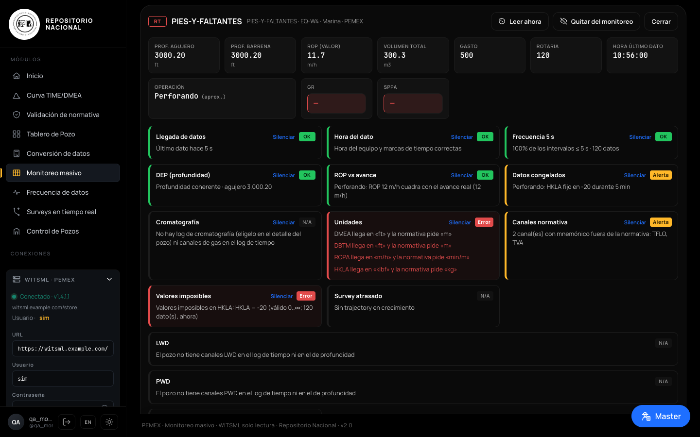 | 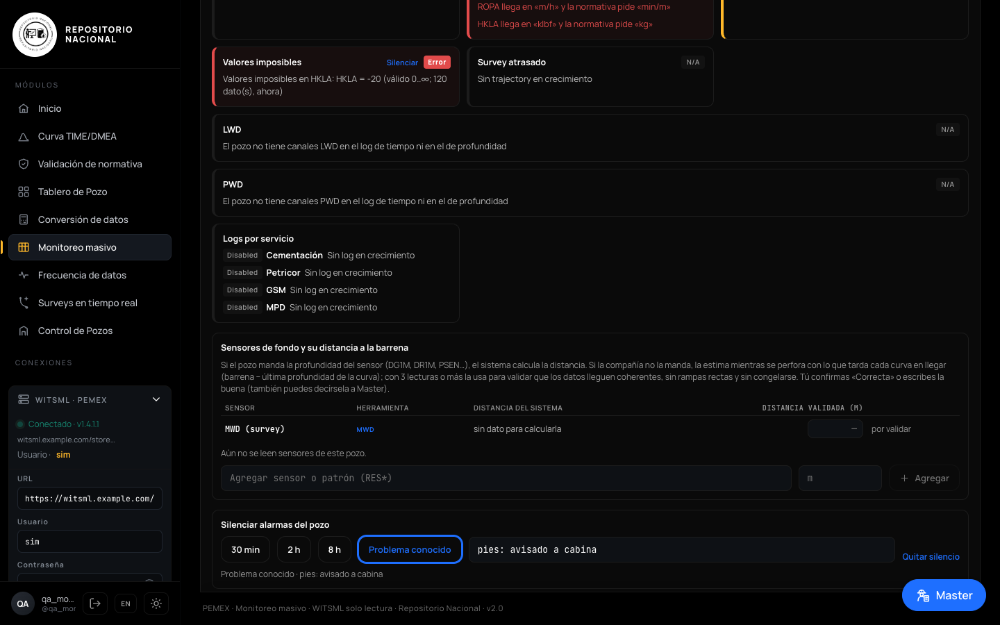 | 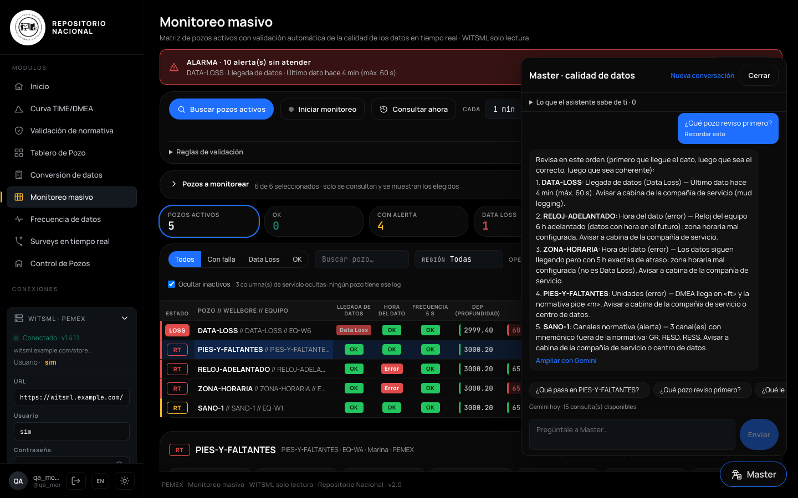 |

## Decisiones importantes

- **WITSML solo lectura, forzado en el código.** Ninguna parte del sistema puede escribir, actualizar ni borrar en el servidor de datos. Hay una lista blanca de operaciones de lectura y pruebas automáticas que lo verifican.
- **Gratis y sin cuentas nuevas.** El asistente Master funciona dentro del navegador, sin servicios externos. La IA (Gemini) solo se usa bajo pedido y con un tope diario para no agotar la cuota gratuita.
- **Configuración por usuario.** Cada usuario recupera su configuración de todos los módulos en cualquier equipo.
- **Probado con simulador.** Se desarrolló y verificó contra un servidor WITSML simulado, sin tocar el servidor real.

## Arquitectura

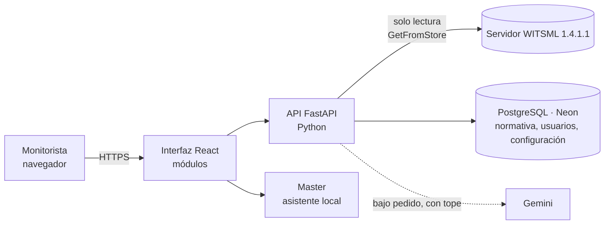

## Tecnología

- **Backend:** Python, FastAPI, cliente SOAP WITSML 1.4.1.1, PostgreSQL (Neon) / SQLite.
- **Frontend:** React, gráficas 2D y 3D (Three.js), diseño responsivo con tema claro y oscuro.
- **Infraestructura:** Vercel (funciones serverless), GitHub Actions (pruebas automáticas).
- **IA:** Gemini para lectura de documentos y resúmenes; asistente local sin IA para el día a día.
- **Calidad:** 268 pruebas automáticas, simulador WITSML y verificación en navegador.

## En números

- ~34 000 líneas de código entre backend y frontend.
- 9 módulos en una sola plataforma con inicio de sesión único.
- Más de 15 validaciones de calidad de datos por pozo, por lectura.

## Más capturas

| | |
|---|---|
| 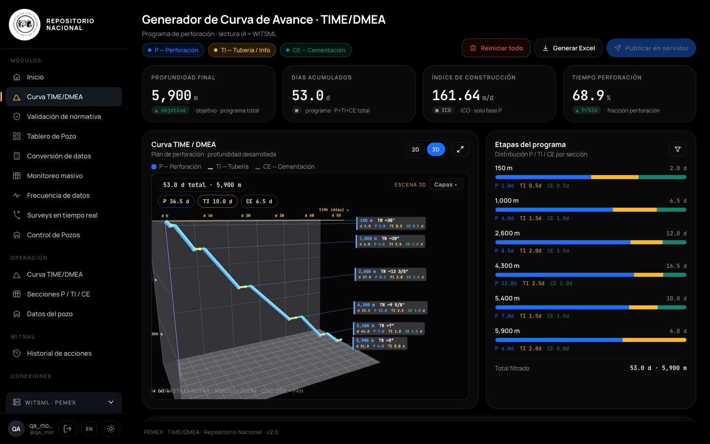 | 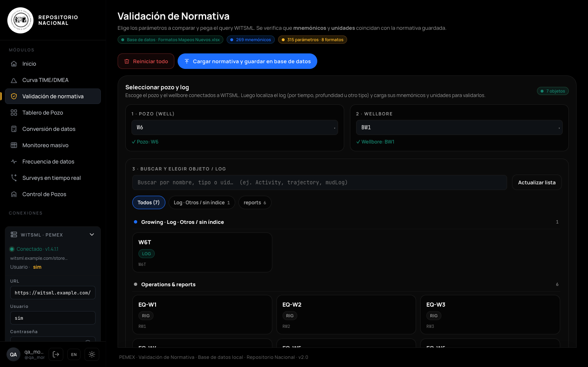 |
| 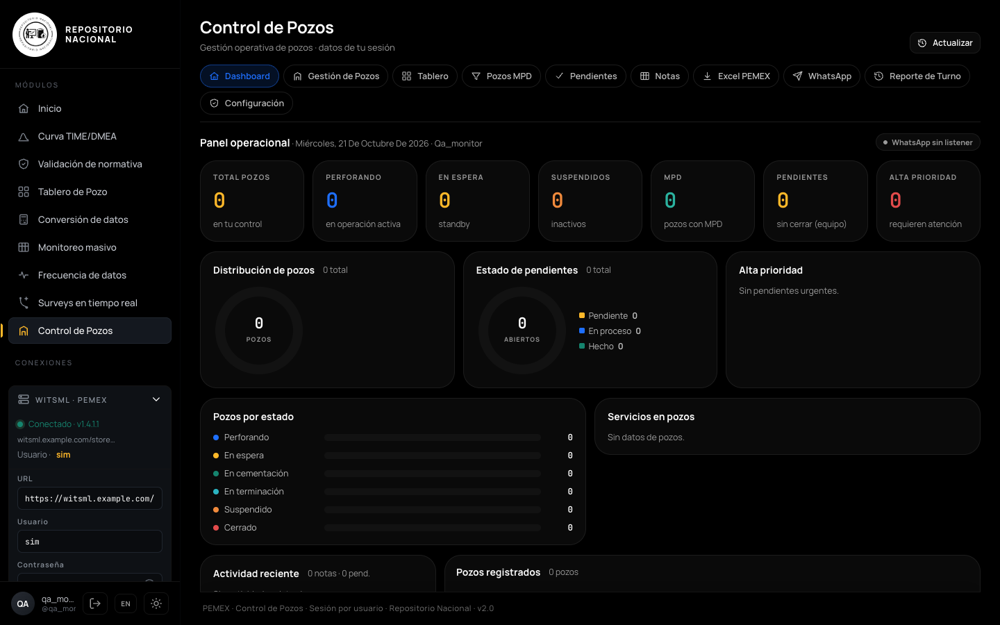 | 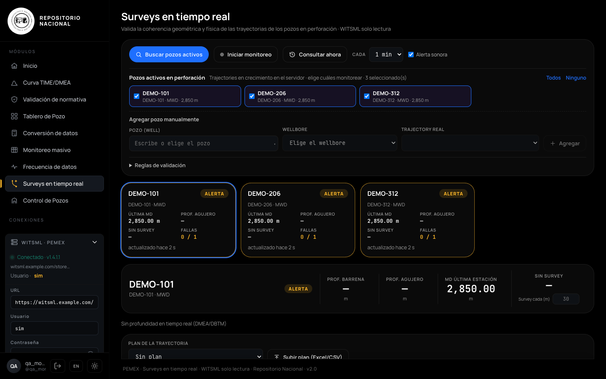 |
| 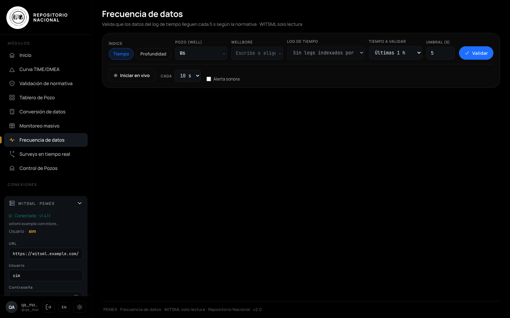 | 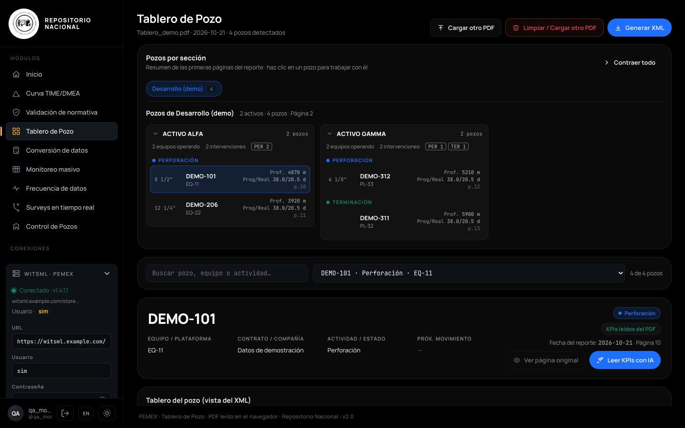 |
| 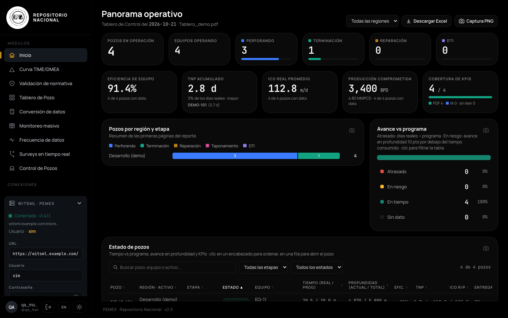 | 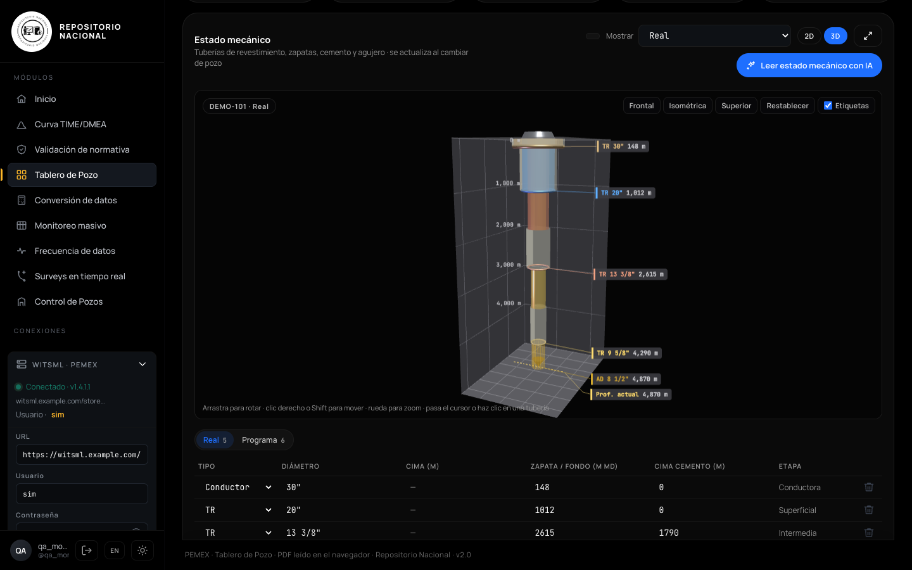 |
| 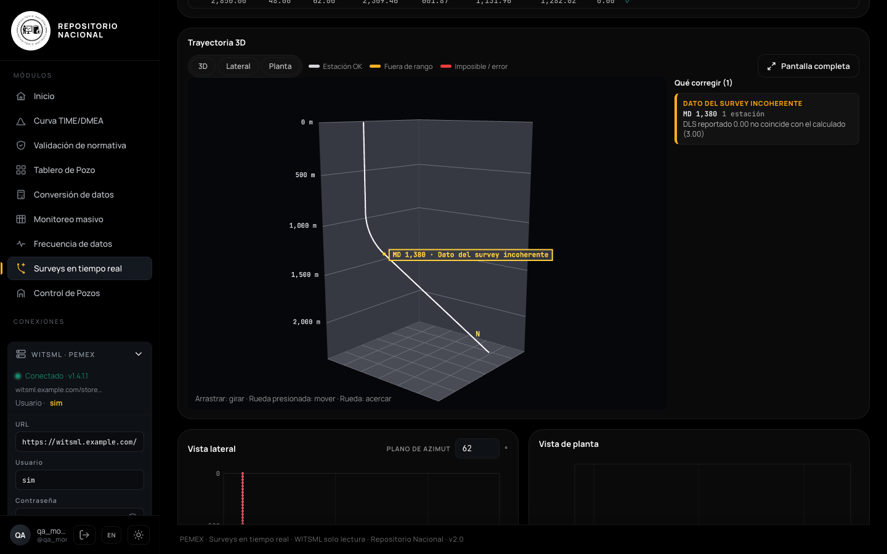 | 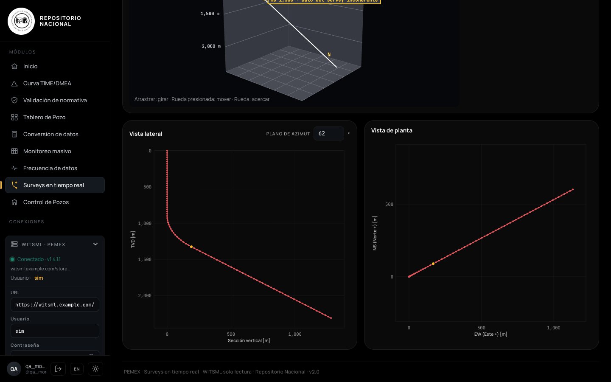 |

---

**Contacto:** [GitHub @Niicko12](https://github.com/Niicko12)
